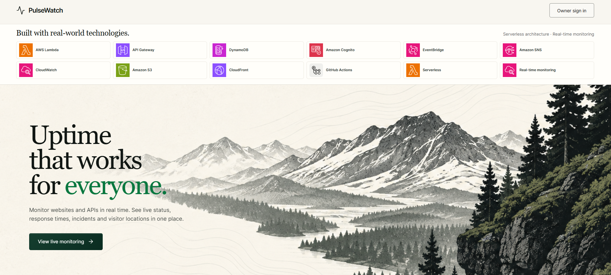
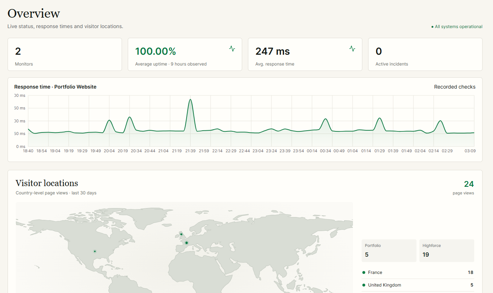

# PulseWatch

[](https://github.com/devmunro/pulsewatch/actions/workflows/checks.yml?query=branch%3Amain)


PulseWatch is a small personal side project for keeping an eye on my live websites. It checks availability and response times, records incidents, and brings live status and country-level visitor page views into one AWS-backed dashboard. I built it as a hands-on way to use a serverless stack on a project I can actually use.

The public dashboard currently follows [Davefolio](https://davefolio.vercel.app/) and [Highforce](https://highforce.agency/). The dashboard is read-only for visitors; owner sign-in is used to manage monitors and the status page. Incident history and affected-site details are available in the responsive dashboard on desktop and mobile.

**[Open the live dashboard](https://d1kd92no8bklbu.cloudfront.net/)**

## Screenshots

### Landing page



### Live monitoring dashboard



## What it does

- Checks configured websites on a schedule and records availability, response time, and status code.
- Tracks incident start and resolution times and displays incident history alongside monitor status.
- Publishes a read-only status view for the monitors selected by the owner.
- Optionally counts aggregate page views by country for sites that include the small PulseWatch tracking script. It records page views, not unique visitors, and the map stays empty until real traffic arrives.
- Keeps monitor management behind owner sign-in; there is no public registration or public editing.
- Provides a responsive dashboard so live status and incident details are easy to review from a phone as well as a desktop.

## How it is built

- **Frontend:** Next.js, React, TypeScript, and Recharts; exported as static files.
- **Hosting:** Amazon S3 and CloudFront.
- **API and checks:** API Gateway and Python AWS Lambda functions, scheduled with EventBridge Scheduler.
- **Data:** DynamoDB on-demand tables for monitors, check history, incidents, and visitor counts.
- **Owner access and operations:** Amazon Cognito for sign-in, CloudWatch for logs, and SNS for incident notification events.
- **Delivery:** GitHub Actions runs checks and uses short-lived AWS credentials through GitHub OIDC.

See [architecture](docs/architecture.md), [security notes](docs/security.md), and [visitor analytics setup](docs/visitor-analytics.md) for implementation details.

## Local development

```bash
npm ci
npm run dev
```

Open the local URL printed by the dev server (typically `http://localhost:5173`). For a production-style static export, run `npm run build:aws`; this writes the deployable frontend to `out/`.

## Checks

```bash
npm run lint
npx playwright install chromium
npm run test:e2e
npm run build:aws
python -m pip install -r backend/requirements-dev.txt
python -m pytest -q -c backend/pyproject.toml backend/tests
python -m ruff check backend/functions backend/tests
cd infrastructure
npm ci
npm run build
npm run synth
```

GitHub Actions runs the frontend, browser, backend, and infrastructure checks for pull requests and pushes to `main`.

## AWS deployment

The production site is hosted at [d1kd92no8bklbu.cloudfront.net](https://d1kd92no8bklbu.cloudfront.net/) in `eu-west-2`. A successful push to `main` automatically triggers the deployment workflow after the checks workflow passes. The workflow builds the static site, prints the CDK diff, and deploys the production stack using GitHub OIDC and the `production` environment.

The workflow also supports a manual preview/deploy path: a run with `deploy=false` shows the CDK diff without deploying; a separate run with `deploy=true` deploys after the diff has been reviewed. Security-sensitive IAM changes still require CDK approval. Routine deployment does not use root credentials or long-lived AWS keys.

AWS Budgets notify the account owner when configured thresholds are reached; they do not cap or automatically stop spending. Serverless usage, CloudFront traffic, data transfer, and logging can incur charges, so check the AWS billing dashboard and budget alerts when operating the stack.

## Privacy and public data

The public dashboard exposes only monitors deliberately selected for the public status page. Published monitor details include their site domain, current status, response information, and related incidents. Visitor analytics are aggregate page-view counts by country; see the [analytics notes](docs/visitor-analytics.md) for the tracking behavior and disclosure.

Never put credentials, tokens, or private endpoints in a monitor URL or commit AWS credentials to the repository.
